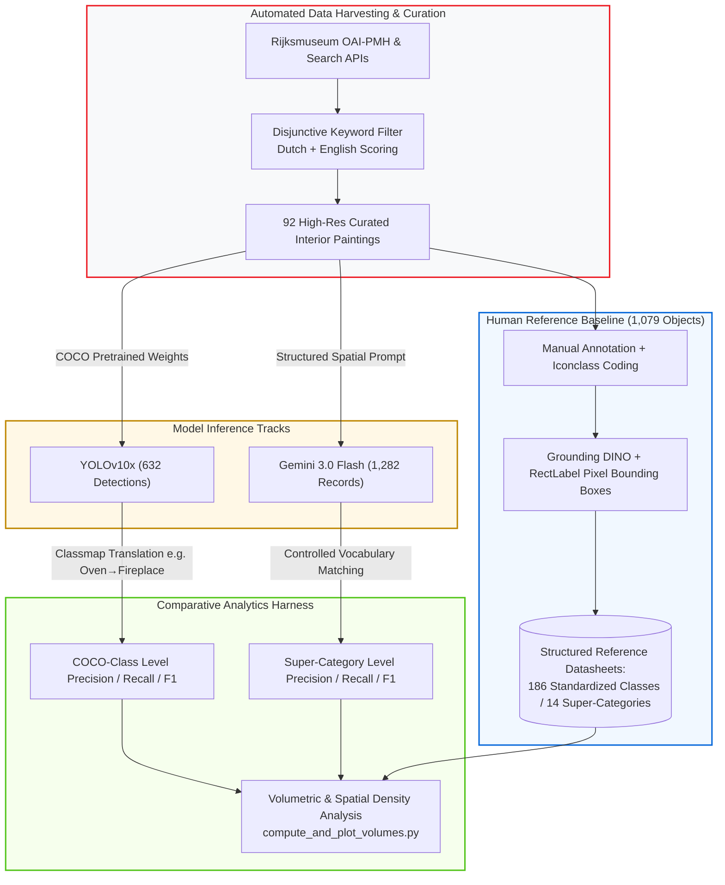

<div align="center">

# 🏛️ How Does AI See Vermeer?
### Empirical Benchmarking & Spatial Analytics of Computer Vision Models on 17th-Century Dutch Interiors

[](https://www.python.org/)
[](https://github.com/THU-MIG/yolov10)
[](https://deepmind.google/)
[](https://data.rijksmuseum.nl/)
[](https://iconclass.org/)

*An open empirical benchmark evaluating domain-shift vulnerability, spatial detection volumes, and taxonomic alignment across one-stage CNN detectors, open-set grounding, and multimodal VLMs on historical visual culture.*

[System Overview](#-system-overview) • [Empirical Benchmark Results](#-empirical-benchmark-results) • [The 31-Point Accuracy Gap](#-the-31-point-accuracy-gap) • [Pipeline & Data Harvest](#-pipeline--data-harvesting) • [Quickstart](#-quickstart)

---

</div>

## 📌 Executive Summary

Deploying off-the-shelf Computer Vision models trained on modern photography (MS COCO) directly to fine art triggers acute **domain shift** and **algorithmic anachronism**—detectors mistake framed paintings for modern televisions, antique cupboards for refrigerators, and fail to segment dense period material culture.

This repository provides the end-to-end benchmarking harness, spatial volume analytics, and comparative evaluation framework across three distinct paradigms on 17th-century Dutch domestic interiors from the **Rijksmuseum**:
1. **One-Stage Object Detection:** `YOLOv10x` (CNN-based real-time bounding boxes bounded by COCO classes)
2. **Open-Vocabulary Grounding:** `Grounding DINO` (text-conditioned bounding box generation verified in RectLabel)
3. **Multimodal Large Language Models:** `Gemini 3.0 Flash` (free-text object detection & spatial layout reasoning)
4. **Human Ground Truth (GT):** 1,079 manually annotated and spatial-bounded records mapped to an **Iconclass-aligned** two-tiered taxonomy.

---

## 🏗️ Benchmarking & Evaluation Pipeline



---

## 📊 Empirical Benchmark Results

### 1. Volumetric and Lexical Asymmetry Across Sources

| Source | Object Records | Painting Coverage | Mean Objects / Painting | Vocabulary Size | Distinct Labels |
| :--- | :---: | :---: | :---: | :---: | :---: |
| **Human Ground Truth** | **1,079** | 86 (100%) | 12.5 (Range: 4–32) | **186** | Controlled, Iconclass-aligned |
| **YOLOv10x** | 632 | 84 (98%) | 7.5 (Range: 1–22) | **28** | Constrained to COCO label set |
| **Gemini 3.0 Flash** | 1,282 | 80 (93%) | 16.0 (Range: 10–25) | **989** | Unstructured descriptive text |

* **Scene-Density Scaling Failure:** Human ground truth dynamically scales with visual crowdedness (4 to 32 objects). Gemini outputs a uniform band (10–25 labels) regardless of complexity, over-describing simple rooms and under-indexing complex domestic spaces.
* **COCO Domain Blindness:** YOLO achieved high precision on modern overlap classes (`person`: P=0.99, R=0.99, F1=0.99; `chair`: F1=0.79; `dog`: F1=0.83), but exhibited near-total failure on period objects (`oven/fireplace`: F1=0.0; `refrigerator/cabinet`: F1=0.0; `tv/painting`: Recall=0.07).

---

## 🔍 The 31-Point Accuracy Gap

On the strictly identical subset of 74 paintings evaluated simultaneously across all three sources:

| Super-Category | YOLOv10x Accuracy | Gemini 3.0 Accuracy | Gap (Gemini − YOLO) | Winning Paradigm |
| :--- | :---: | :---: | :---: | :--- |
| **Architecture** | 0.34 | **0.65** | **+0.31** | **Gemini (+31 pts)** |
| **Furniture** | 0.61 | **0.88** | **+0.27** | **Gemini (+27 pts)** |
| **Instrument** | 0.74 | **0.88** | **+0.14** | **Gemini (+14 pts)** |
| **People** | **0.97** | 0.82 | **-0.15** | **YOLO (+15 pts)** |
| **Clothing** | **0.78** | 0.65 | **-0.14** | **YOLO (+14 pts)** |

### Core Engineering Takeaways
- **Where Multimodal VLMs Excel (+31 point delta):** Structural and spatial context (walls, fireplaces, archways, instruments) where COCO lacks discrete label equivalents.
- **Where Traditional CV Prevails:** Rigorous spatial localization of human figures (`person`), where VLMs over-segment clothing layers into separate, non-standardized objects.
- **Hybrid Recommendation:** Robust production visual analysis in cultural or complex historical domains requires coupling one-stage spatial localization models for primary entities with multimodal reasoning backbones for open-set contextual verification.

---

## 🚀 Quickstart & Reproduction

### 1. Setup Environment
```bash
git clone [https://github.com/Wenxuan-Luo11/Vermeer-CV-Benchmark.git](https://github.com/Wenxuan-Luo11/Vermeer-CV-Benchmark.git)
cd Vermeer-CV-Benchmark

python3 -m venv venv
source venv/bin/activate
pip install -r requirements.txt
```

### 2. Run Object Detection Evaluation
```bash
# Evaluate YOLOv10x detections against mapped Ground Truth
python yolo_eval.py

# Run volumetric distribution and spatial density analysis
python compute_and_plot_volumes.py
```

### 3. Notebooks
- `Grounding_DINO.ipynb`: Automated candidate bounding box generation pipeline used for manual review in RectLabel.

---

## 👥 Contributors & Academic Context

Conducted as part of the **Embedded Research Project (ERP)** at the **University of Amsterdam**.

*Evaluated using the open collections of the **Rijksmuseum Amsterdam**.*

---

## 📜 License
Distributed under the **MIT
